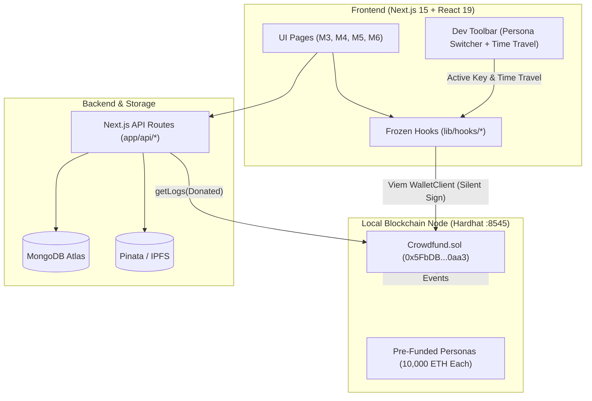

# TrustFund 🚀

> **A decentralized, trustless crowdfunding platform powered by Ethereum smart contracts, zero middlemen, and automated escrow.**

TrustFund replaces traditional middlemen (like Kickstarter or GoFundMe) with an unbreakable, transparent Solidity smart contract. Contributed funds are locked in escrow and only unlocked if the funding goal is met before the deadline. If the goal is not met, backers can independently claim full, automated refunds.

---

## 📑 Table of Contents
1. [The Problem & The Solution](#1-the-problem--the-solution)
2. [Team Members & Module Ownership](#2-team-members--module-ownership)
3. [Architecture & Zero-MetaMask Demo Engine](#3-architecture--zero-metamask-demo-engine)
4. [Tech Stack](#4-tech-stack)
5. [Quickstart & Running Locally](#5-quickstart--running-locally)
6. [End-to-End Demo Walkthrough](#6-end-to-end-demo-walkthrough)
7. [Smart Contract Reference](#7-smart-contract-reference)
8. [Testing & Build Verification](#8-testing--build-verification)
9. [Security Features](#9-security-features)

---

## 1. The Problem & The Solution

| Challenge on Web2 Platforms | TrustFund Web3 Solution |
| :--- | :--- |
| **Centralized Custody**: Platforms hold user money and charge high 5–10% platform cuts. | **Non-Custodial Escrow**: Funds are locked directly inside `Crowdfund.sol` on-chain. |
| **Opaque Policies**: If a project fails, backers must wait on customer support or bank chargebacks. | **Automated Code-Enforced Refunds**: If the goal isn't met by the deadline, backers claim their refund in 1 click. |
| **Censorship & Freezes**: Central entities can arbitrarily freeze creator campaigns. | **Immutable Logic**: Rules are published to the blockchain and cannot be tampered with. |
| **Friction-Heavy Demos**: Traditional Web3 dApps require browser wallet extensions, testnet faucets, and confirmation popups. | **Zero-MetaMask Persona Switcher**: In-app signing with pre-funded demo personas and EVM time travel. |

---

## 2. Team Members & Module Ownership

The project was engineered collaboratively using strict modular ownership governed by [`AGENTS.md`](./AGENTS.md):

| Member | Role | Owned Files & Directories | Core Responsibilities |
| :--- | :--- | :--- | :--- |
| **M1** | **Blockchain & Wallet** | `contracts/`<br>`scripts/`<br>`test/`<br>`lib/wagmi.ts`<br>`lib/hooks/*`<br>`lib/abi/`<br>`app/providers.tsx`<br>`hardhat.config.ts` | • `Crowdfund.sol` smart contract & 12 Hardhat unit tests<br>• Local Hardhat node configuration, deploy & seed scripts<br>• Custom persona engine (`lib/hooks/_personas.ts`) & Viem clients<br>• 8 frozen silent-signing React hooks (`useWallet`, `useDonate`, etc.)<br>• Interactive Dev Toolbar (Persona Switcher + Time Travel) |
| **M2** | **Backend & API** | `app/api/`<br>`lib/api.ts`<br>`models/`<br>`lib/mock/` | • REST API endpoints (`/api/campaigns`, `/api/upload`, `/api/users`)<br>• MongoDB Mongoose schemas (`Campaign`, `ContributionCache`, `User`)<br>• Pinata IPFS file upload integration<br>• On-chain `Donated` event log caching and query aggregation |
| **M3** | **Home Page & Layout** | `app/page.tsx`<br>`app/layout.tsx`<br>`components/layout/`<br>`components/home/` | • Main landing page, Hero section with live aggregate chain statistics<br>• Search bar with real-time text query and category tag filtering<br>• Campaign grid with skeleton loaders and empty states<br>• Global responsive navigation header and footer |
| **M4** | **Campaign Detail Page** | `app/campaign/`<br>`components/campaign/` | • Campaign header, description, and metadata presentation<br>• Real-time progress bar, MATIC goal vs. raised tracker<br>• Live countdown timer with expired state handling<br>• `DonateBox` with quick-pick presets and donation execution<br>• `ActionPanel` (conditional Creator Withdraw vs. Backer Refund)<br>• `BackersList` showing recent transactions with explorer links |
| **M5** | **Create Campaign Page** | `app/create/`<br>`components/create/` | • Multi-step campaign creation wizard<br>• Drag-and-drop image dropzone with IPFS CID generation<br>• Deadline picker (calendar input + 7, 30, 60-day quick presets)<br>• On-chain transaction submission synchronized with MongoDB metadata |
| **M6** | **Dashboard Page** | `app/dashboard/`<br>`components/dashboard/` | • User portfolio overview ("My Campaigns" and "My Contributions" tabs)<br>• Filtered campaign cards reflecting active persona's created projects<br>• Detailed breakdown of backed campaigns and individual contribution amounts |

### Shared Core Infrastructure
* `lib/types.ts` — Canonical TypeScript domain interfaces (`CampaignMeta`, `CampaignChain`, `Contribution`, etc.)
* `lib/constants.ts` — Chain configuration, deterministic contract address, and category tags
* `lib/format.ts` — Formatting helpers (`weiToMatic`, `maticToWei`, `percentFunded`, `shortAddress`, `ipfsUrl`)
* `components/ui/*` — Reusable component library (Button, Modal, Badge, ProgressBar, Spinner)

---

## 3. Architecture & Zero-MetaMask Demo Engine

TrustFund operates on a hybrid on-chain / off-chain architecture:
* **On-Chain (Solidity)**: Handles all financial truth, escrow, deadline rules, donations, withdrawals, and refunds.
* **Off-Chain (MongoDB Atlas + IPFS)**: Handles rich media, long-form descriptions, creator profiles, and search indexes.



### The In-App Persona Engine
To eliminate testnet faucet failures, RPC lag, and repetitive MetaMask confirmation popups during presentations, the dApp features a built-in **Persona Engine** powered by `viem/accounts`:

* 👩‍💼 **Alice (Creator)** — `0xf39Fd6e51aad88F6F4ce6aB8827279cffFb92266` (10,000 ETH)
* 👨‍🔧 **Bob (Backer 1)** — `0x70997970C51812dc3A010C7d01b50e0d17dc79C8` (10,000 ETH)
* 🧑‍🎨 **Charlie (Backer 2)** — `0x3C44CdDdB6a900fa2b585dd299e03d12FA4293BC` (10,000 ETH)

Transactions are signed in code via `createWalletClient` and execute instantly (< 100ms) with zero popups.

### EVM Time Travel
Campaigns enforce minimum 1-hour durations on-chain. To demo end-to-end expiration without waiting days:
* Clicking **`+2 Hours`** or **`+7 Days`** sends raw JSON-RPC requests (`evm_increaseTime` and `evm_mine`) to the local node.
* A reactive client store shifts UI deadlines, instantly flipping campaigns into **"Ended"** state and revealing the **Withdraw** / **Claim Refund** action panels!

---

## 4. Tech Stack

* **Blockchain**: Solidity `^0.8.20`, Hardhat `^2.29.1`, OpenZeppelin Contracts (`ReentrancyGuard`)
* **Web3 Client**: Viem `^2.56.0`, Wagmi `^3.7.7`, `@tanstack/react-query` `^5.102.8`
* **Frontend**: Next.js `15.3.4` (App Router), React `19`, TypeScript, Tailwind CSS
* **Database & Storage**: MongoDB Atlas via Mongoose `^8.13.0`, Pinata Cloud (IPFS)
* **Date & Utility**: `date-fns`, `lucide-react`

---

## 5. Quickstart & Running Locally

### Prerequisites
* **Node.js** (v20+ or v22 LTS)
* **npm** (v10+)

### 1. Clone & Install
```bash
git clone [https://github.com/Sakall-code/TrustFund.git
cd crowdfund
npm install
```

### 2. Environment Configuration
Copy the template to `.env.local`:
```bash
cp .env.example .env.local
```
Ensure `.env.local` contains:
```env
NEXT_PUBLIC_CHAIN_ID=31337
NEXT_PUBLIC_CONTRACT_ADDRESS=0x5FbDB2315678afecb367f032d93F642f64180aa3
NEXT_PUBLIC_DEPLOY_BLOCK=0
NEXT_PUBLIC_RPC_URL=http://127.0.0.1:8545

# Database & IPFS
MONGODB_URI=your_mongodb_connection_string
PINATA_JWT=your_pinata_jwt_token
```

> **Important Notes Before Seeding & Demoing:**
> - **MongoDB Atlas Prerequisite:** Ensure `MONGODB_URI` in `.env.local` is valid and your IP (or `0.0.0.0/0`) is whitelisted under **Network Access** in MongoDB Atlas before running `scripts/seed.ts`, as the seed script writes off-chain campaign metadata to MongoDB alongside on-chain transactions.
> - **ETH vs. MATIC Denomination:** On the local Hardhat EVM node, native test balances are denominated in `ETH` by the node (`10,000 ETH`), while the frontend UI labels native currency as `MATIC` (matching Polygon's native token). Both refer to the exact same 18-decimal native coin (`1 ETH = 1 MATIC` in local mode).

### 3. Startup Commands (3 Terminals)

#### **Terminal 1 — Local Blockchain Node**
```bash
npx hardhat node
```
*Starts the local Ethereum RPC node at `http://127.0.0.1:8545`.*

#### **Terminal 2 — Deploy Contract & Seed Demo Data**
```bash
npx hardhat run scripts/deploy.ts --network localhost
npx hardhat run scripts/seed.ts --network localhost
```
*Deploys `Crowdfund.sol` to `0x5FbDB2315678afecb367f032d93F642f64180aa3` and populates active campaigns with test backer donations.*

#### **Terminal 3 — Start the Next.js Frontend**
```bash
npm run dev
```
*Open [http://localhost:3000](http://localhost:3000) in your browser.*

---

## 6. End-to-End Demo Walkthrough

### Scenario A: Successful Campaign & Creator Withdrawal
1. In the bottom-right **Dev Toolbar**, click **Alice (Creator)**.
2. Navigate to **Create** (`/create`) and launch a campaign with a **10 ETH** goal.
3. Switch the persona to **Bob (Backer 1)**.
4. Open the campaign page, enter **10 ETH**, and click **Donate**. The transaction confirms instantly.
5. In the Dev Toolbar, click **`+7 Days`** to fast-forward past the campaign deadline.
6. Switch back to **Alice (Creator)**: the green **"Withdraw 10 MATIC"** button appears.
7. Click **Withdraw**: 10 ETH transfers directly to Alice's balance on-chain!

### Scenario B: Failed Campaign & Automated Backer Refund
1. Switch to **Alice (Creator)** and launch a campaign with a **50 ETH** goal.
2. Switch to **Charlie (Backer 2)** and donate **5 ETH** (goal not met).
3. In the Dev Toolbar, click **`+7 Days`** to expire the campaign.
4. Keep **Charlie** selected: the red **"Claim refund of 5 MATIC"** button appears.
5. Click **Claim Refund**: 5 ETH is returned to Charlie's balance instantly!

---

## 7. Smart Contract Reference

The contract is located at [`contracts/Crowdfund.sol`](./contracts/Crowdfund.sol):

| Method | Access | State Mutability | Description |
| :--- | :--- | :--- | :--- |
| `createCampaign(goal, deadline, metadataCid)` | Public | Nonpayable | Increments `campaignCount` (1-based), stores creator and goal, emits `CampaignCreated`. |
| `donate(id)` | Public | Payable | Accepts native ETH, increases `campaign.raised`, tracks backer contribution, emits `Donated`. |
| `withdraw(id)` | Campaign Owner | Nonpayable | Reentrancy-guarded. Unlocks only if `block.timestamp >= deadline` AND `raised >= goal`. |
| `claimRefund(id)` | Backers | Nonpayable | Reentrancy-guarded. Allows backers to retrieve 100% of their ETH if `raised < goal` after deadline. |
| `contributions(id, backer)` | Public | View | Returns the total Wei contributed by a specific backer address to campaign id. |
| `getCampaign(id)` | Public | View | Returns `(owner, goal, deadline, raised, claimed, metadataCid)`. |
| `campaignCount()` | Public | View | Returns total number of created campaigns. |

### Emitted Events
* `CampaignCreated(uint256 indexed id, address indexed owner, uint256 goal, uint256 deadline, string metadataCid)`
* `Donated(uint256 indexed id, address indexed backer, uint256 amount)`
* `Withdrawn(uint256 indexed id, address indexed owner, uint256 amount)`
* `Refunded(uint256 indexed id, address indexed backer, uint256 amount)`

### Contract Deployments
| Environment | Chain ID | Contract Address | Notes |
| :--- | :--- | :--- | :--- |
| **Local Hardhat Node** | `31337` | `0x5FbDB2315678afecb367f032d93F642f64180aa3` | Deterministic local deployment for instant zero-popup demos |
| **Polygon Amoy Testnet** | `80002` | `0xBC3D6E864A642C4bb0E2aa2a835F52F1B5C02890` | Deployed on public Polygon Amoy testnet at block `52658507` |

---

## 8. Testing & Build Verification

### Smart Contract Unit Tests
Execute the full test suite with coverage of deadline requirements, refunds, owner privileges, and reentrancy:
```bash
npx hardhat test
```
```text
  Crowdfund
    ✔ 1. create campaign stores correct values and increments campaignCount
    ✔ 2. donate increases raised and the backer's contribution mapping
    ✔ 3. donate after deadline reverts
    ✔ 4. withdraw before deadline reverts
    ✔ 5. withdraw when goal not met reverts
    ✔ 6. withdraw by non-owner reverts
    ✔ 7. successful withdraw transfers full balance and sets claimed
    ✔ 8. second withdraw reverts
    ✔ 9. claimRefund when goal met reverts
    ✔ 10. claimRefund when goal failed returns exact contributed amount
    ✔ 11. second claimRefund by the same backer reverts
    ✔ 12. a malicious reentrant contract cannot drain funds

  12 passing (1s)
```

### Next.js Production Build
```bash
npm run build
```
*Compiles all App Router pages and API routes with zero TypeScript or ESLint errors.*

---

## 9. Security Features

* **Checks-Effects-Interactions (CEI)**: State variables (`claimed = true`, `contributions[id][msg.sender] = 0`) are updated *before* any external ETH transfers take place.
* **OpenZeppelin ReentrancyGuard**: Both `withdraw` and `claimRefund` are protected with the `nonReentrant` modifier to prevent recursive callback attacks.
* **Strict Parameter Bounds**: Prevents zero goals (`InvalidGoal`), empty metadata (`InvalidMetadata`), zero donations (`InvalidDonation`), and past deadlines (`InvalidDeadline`).
* **Environment Isolation**: Private keys are strictly local test credentials; production deployments require external hardware wallet or audited signer configuration.
