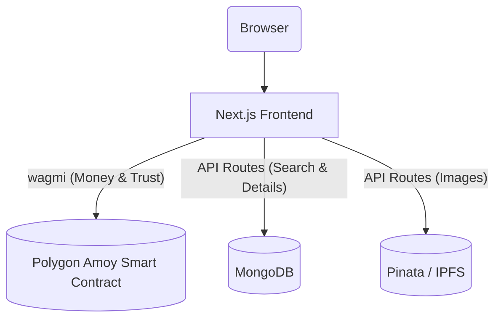

# TrustFund

A decentralized crowdfunding platform ensuring secure, goal-driven fund allocation without the need for a central middleman. 

- **Live Demo**: [TODO: Insert Live URL]
- **Verified Contract**: [TODO: Insert Polygonscan URL]

---

## 1. The Problem
On traditional platforms like Kickstarter or GoFundMe, you must trust a company to hold and release the money. If a project fails to meet its funding goal, you rely on their customer support and internal policies to get a refund. You are putting your trust in a middleman rather than the creator or the community.

## 2. The Solution
TrustFund locks all contributed funds in a public smart contract. Withdrawal only unlocks if the funding goal is met by the deadline. If the goal is missed, refunds are automatic and guaranteed by the code itself. There is no customer support to contact and no corporate policy to navigate—just transparent, unbreakable rules.

## 3. Features
- **Decentralized Escrow**: Funds are locked safely until goals are met.
- **Automated Refunds**: Instant refund capability if a campaign fails.
- **Gasless-like Experience**: Built on the low-cost Polygon network.
- **Rich Media**: IPFS integration ensures decentralized image hosting.
- **Personal Dashboard**: Track campaigns you've created and backed in one place.

## 4. Tech Stack

| Technology | Why We Chose It |
|---|---|
| **Polygon Amoy + Solidity** | Fast, extremely cheap transactions with Ethereum-level security. |
| **Next.js + TypeScript + Tailwind** | Rapid frontend development with strong type safety and modern styling. |
| **wagmi + RainbowKit** | The most reliable and developer-friendly way to connect wallets. |
| **MongoDB Atlas** | Fast querying for off-chain metadata (titles, descriptions, tags). |
| **Pinata/IPFS** | Permanent, decentralized storage for campaign images. |
| **Vercel** | Seamless edge deployment for Next.js applications. |

## 5. Architecture


*Note: Only money and trust-critical data goes on-chain. Everything else is handled off-chain for performance and cost-efficiency.*

## 6. How the Money Flows (The 5 Steps)
1. **Create**: A creator launches a campaign with a specific goal and deadline.
2. **Donate**: Backers send MATIC, which is held in escrow by the smart contract.
3. **Wait**: The campaign runs until the deadline.
4. **Withdraw (Goal Met)**: If the goal is reached, the creator can withdraw all funds.
5. **Refund (Goal Missed)**: If the deadline passes and the goal isn't met, backers can independently claim their refunds.

## 7. Local Setup

**Prerequisites:** Node.js (v20+), Git.

1. Clone the repository:
   ```bash
   git clone [TODO: Insert Repo URL] crowdfund
   cd crowdfund
   ```
2. Install dependencies:
   ```bash
   npm install
   ```
3. Set up environment variables. Create a `.env.local` file:
   ```env
   NEXT_PUBLIC_WALLETCONNECT_PROJECT_ID=your_project_id
   NEXT_PUBLIC_CONTRACT_ADDRESS=your_deployed_contract
   MONGODB_URI=your_mongodb_connection_string
   PINATA_API_KEY=your_pinata_key
   PINATA_SECRET_API_KEY=your_pinata_secret
   ```
4. Compile and deploy the smart contract (if editing):
   ```bash
   npx hardhat compile
   npx hardhat test
   npx hardhat run scripts/deploy.ts --network amoy
   ```
5. Run the frontend:
   ```bash
   npm run dev
   ```

## 8. Smart Contract Reference

| Function | Arguments | Who can call? | Description |
|---|---|---|---|
| `createCampaign` | `goalWei`, `deadline` | Anyone | Creates a new campaign and sets the funding target. |
| `donate` | `campaignId` (payable) | Anyone | Contributes MATIC to a specific active campaign. |
| `withdraw` | `campaignId` | Campaign Owner | Transfers all raised funds to the owner if the goal is met. |
| `claimRefund` | `campaignId` | Backers | Returns a backer's contribution if the campaign failed. |

## 9. Security Notes
- **Reentrancy Protection**: All state changes happen before funds are transferred (Checks-Effects-Interactions pattern), backed up by OpenZeppelin's `ReentrancyGuard`.
- **Timestamp Drift**: Block timestamps can drift by a few seconds. This is acceptable since campaigns run for 30 days, making second-level precision irrelevant.

## 10. Known Limitations & Future Work
- **Testnet Only**: Currently deployed on Polygon Amoy. Not for real money.
- **No KYC**: Anyone can create a campaign. Scams are theoretically possible.
- **No Partial Funding**: Campaigns must hit 100% of their goal or they fail.
- **No Editing**: Once created, campaign details cannot be changed.
- **Centralized Metadata**: Off-chain data (MongoDB) is not censorship-resistant.

## 11. The Team

| Name | Role | Modules Owned |
|---|---|---|
|  |  |  |
|  |  |  |
|  |  |  |
|  |  |  |
|  |  |  |
|  |  |  |
